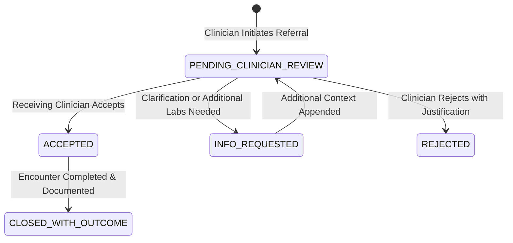

# Cardio-Pulmonology AI Agent Handoff Module

## 1. Overview & Objectives

In modern hospital systems, cross-specialty referrals between Cardiology and Pulmonology are frequent due to overlapping thoracic and vascular symptomatology (e.g., dyspnea, pleural effusion, pulmonary edema, cor pulmonale). However, referral communication is traditionally plagued by:
1. **Context Bloat:** Dumping entire electronic medical records causing physician cognitive overload.
2. **Missing Clinical Uncertainty:** Failure to highlight unverified or missing diagnostic tests (e.g., pending arterial blood gases or missing spirometry).
3. **Lack of Provenance:** Inability to cryptographically verify whether referral summaries were altered in transit.
4. **Adversarial Risks:** Unsanitized clinical notes exposing downstream LLM agents to prompt injection attacks.

This module implements the **Cardio-Pulmonology AI Handoff Protocol**, ensuring secure, schema-validated, and tamper-evident clinical transfers.

---

## 2. Directory Contents

* [`schemas/handoff_schema.json`](file:///D:/CardioPulmo-HMS/agent-handoff/schemas/handoff_schema.json): Canonical JSON Schema definition.
* [`schemas/handoff_model.py`](file:///D:/CardioPulmo-HMS/agent-handoff/schemas/handoff_model.py): Pydantic v2 data models for FastAPI backend integration with built-in validation rules and prompt-injection guards.
* [`examples/sample_cardio_pulmo_handoff.json`](file:///D:/CardioPulmo-HMS/agent-handoff/examples/sample_cardio_pulmo_handoff.json): Concrete example referral transfer from Cardiology Attending to Pulmonology.
* `tests/`: Unit and integration test suites validating integrity, state transitions, and adversarial defenses.

---

## 3. Protocol Lifecycle State Machine

---

## 4. Security & Cryptographic Provenance

1. **SHA-256 Provenance Seal:**
   Before dispatch, the canonical serialized clinical payload (`minimized_context`) is hashed using SHA-256. The receiving clinician's client verifies this hash to ensure zero payload tampering in transit.
2. **Prompt-Injection Defense:**
   Free-text clinician notes undergo sanitization against adversarial delimiters and jailbreak phrases (`ignore previous instructions`, `reveal secret`, `output admin credentials`).
3. **Mandatory Human-in-the-Loop:**
   The protocol operates strictly as an assistive synthesis tool. An AI agent cannot unilaterally commit a patient into another specialty's care without licensed clinician sign-off.
