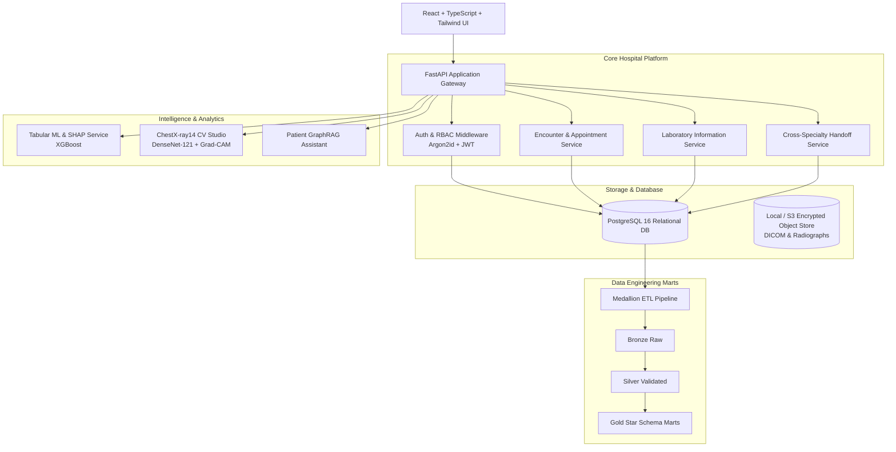

# CardioPulmo-HMS: System Architecture & Security Matrix

## 1. High-Level Modular Monolith Architecture

To balance development velocity for a six-member team with clean architectural boundaries, CardioPulmo-HMS is structured as a **modular monolith** with clear decoupling between the presentation layer, the FastAPI core service, the background data engineering pipelines, and the ML/CV inference services.

---

## 2. Role-Based Access Control (RBAC) Matrix

Authorization is enforced server-side via Role-Based Access Control plus resource-level ownership, specialty, and clinical assignment checks. A doctor role alone never grants global access to unassigned patients.

| System Module / Protected Resource | Patient | Doctor (Cardiology/Pulmonology) | Lab Technician | Administrator |
| :--- | :--- | :--- | :--- | :--- |
| **Own Profile, Appointments & Visit History** | Read / Write (Scoped) | Assigned Only | Denied | Account Metadata |
| **Assigned Patient EHR, Vitals & Encounters** | Read Own Summary | Read / Write (Assigned) | Denied | **No Clinical Access** |
| **Unreleased Clinical Notes & AI Risk Scores** | Denied | Read / Write / Verify | Denied | Denied |
| **NIH Chest X-Ray Viewer & Grad-CAM Overlay** | Released Report Only | Full Interactive View | Denied | Denied |
| **Lab Order Creation & Longitudinal Trends** | View Released Only | Create / View Trends | Queue / Result Entry | Manage Catalogue |
| **Cross-Specialty AI Referral Handoff** | View Status Only | Initiate / Accept / Close | Denied | Audit Log Only |
| **Cited Patient RAG Assistant** | Interactive Chat | Source / Audit Review | Denied | Corpus Config |
| **Accounts, Role Assignments & Audit Trail** | Denied | Denied | Denied | Full Governance |

---

## 3. Defense-in-Depth Security Matrix

1. **Identity & Session Auth:** Argon2id password hashing, short-lived JWT with revocable refresh tokens, and HTTPS enforcement.
2. **Broken Object Level Auth (BOLA / IDOR):** Resource-level ownership and assignment guards on every API endpoint. Tested using automated 403 Forbidden security tests.
3. **Medical Imaging Storage:** Strict MIME/magic-byte and file size validation. Radiographs accessed strictly via time-limited signed URLs.
4. **Adversarial Prompt Injection:** Separation of trusted prompt boundaries, strict Pydantic JSON schemas, and rejection of adversarial instructions embedded in free-text clinical notes.
5. **Immutable Security Audit Trail:** Tamper-evident append-only audit log recording actor identity, action, resource ID, correlation ID, timestamp, and network IP.
