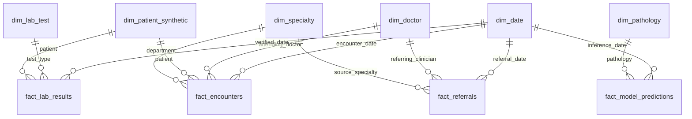

# CardioPulmo-HMS: Data Dictionary & Star Schema

## 1. Relational Operational Schema (OLTP)

The operational database (PostgreSQL 16) captures transactions and clinical encounters with strict relational constraints:

* `users`: `user_id` (UUID, PK), `email`, `password_hash` (Argon2id), `role` (`patient`, `doctor`, `lab`, `admin`), `specialty` (`CARDIOLOGY`, `PULMONOLOGY`, `PATHOLOGY_LIS`, `GOVERNANCE`), `status`, `created_at`.
* `patients`: `patient_id` (UUID, PK), `user_id` (FK to users), `mrn` (unique), `first_name`, `last_name`, `dob`, `gender`, `blood_type`, `phone`, `emergency_contact`.
* `encounters`: `encounter_id` (UUID, PK), `patient_id` (FK), `clinician_id` (FK), `specialty`, `encounter_type`, `chief_complaint`, `soap_subjective`, `soap_objective`, `soap_assessment`, `soap_plan`, `status`, `created_at`.
* `vitals`: `vital_id` (UUID, PK), `encounter_id` (FK), `bp_systolic`, `bp_diastolic`, `heart_rate`, `spo2`, `respiratory_rate`, `temperature`, `recorded_at`.
* `lab_orders`: `order_id` (UUID, PK), `encounter_id` (FK), `patient_id` (FK), `ordering_clinician_id` (FK), `priority` (`ROUTINE`, `URGENT`, `STAT`), `status`, `ordered_at`.
* `specimens`: `specimen_id` (UUID, PK), `order_id` (FK), `specimen_type`, `collected_at`, `received_at`, `status`, `rejection_reason`.
* `lab_results`: `result_id` (UUID, PK), `order_id` (FK), `test_code` (LOINC), `numeric_value`, `text_value`, `unit`, `ref_min`, `ref_max`, `flag` (`NORMAL`, `LOW`, `HIGH`, `CRITICAL`), `status`, `verified_by` (FK), `verified_at`.
* `referrals`: `referral_id` (UUID, PK), `correlation_id` (unique), `encounter_id` (FK), `patient_id` (FK), `sender_clinician_id` (FK), `source_specialty`, `dest_specialty`, `reason`, `status`, `provenance_sha256`, `created_at`.
* `security_audits`: `audit_id` (UUID, PK), `timestamp`, `actor_id`, `role`, `action`, `resource_id`, `correlation_id`, `status_code`, `details`, `ip_address`.

---

## 2. Gold Star Schema Analytical Model (OLAP)

The Medallion ETL pipeline extracts validated Silver records and loads them into a dimensional Star Schema optimized for operational, epidemiological, and model evaluation reporting:

### Fact Tables:
1. `fact_appointments`: Grain = One row per patient booking.
2. `fact_encounters`: Grain = One row per clinical visit.
3. `fact_lab_results`: Grain = One row per verified diagnostic lab item.
4. `fact_referrals`: Grain = One row per cross-specialty referral transaction.
5. `fact_model_predictions`: Grain = One row per model inference (Tabular ML or Chest X-Ray CV).

### Dimension Tables:
* `dim_date`: Calendar attributes (day, month, quarter, year, weekday).
* `dim_specialty`: Clinical department metadata (Cardiology, Pulmonology, Laboratory).
* `dim_lab_test`: LOINC mappings, analytical methods, reference intervals.
* `dim_doctor`: Clinician credentialing, assigned department.
* `dim_patient_synthetic`: Age brackets, gender, baseline comorbidities.
* `dim_pathology`: 14 NIH ChestX-ray14 condition metadata (category, threshold).
