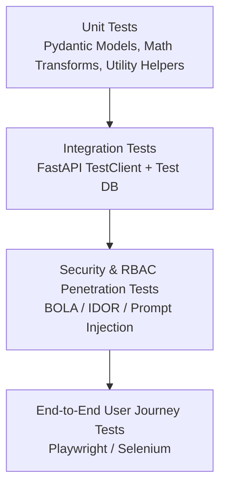

# CardioPulmo-HMS: Comprehensive Test Strategy

## 1. Testing Pyramid & Verification Gates

CardioPulmo-HMS enforces a multi-tier testing strategy ensuring clinical safety, API security, and pipeline reproducibility:

---

## 2. Test Suites by Module

1. **Security & Authorization (`tests/security/`):**
   * Verification of 403 Forbidden responses when Patient A requests Patient B's laboratory data.
   * Verification that Administrator tokens cannot query clinical encounter or SOAP endpoints.
   * Adversarial prompt-injection attack test suite against referral notes.
2. **Clinical Laboratory Lifecyle (`tests/lis/`):**
   * State transitions: Ordered &rarr; Collected &rarr; Processing &rarr; Completed.
   * Enforcement of mandatory justification string when amending released results.
3. **Data Engineering & Lineage (`tests/data/`):**
   * Great Expectations schema validation on Silver and Gold tables.
   * Unit conversions and duplicate rejection verification.
4. **Machine Learning & Computer Vision (`tests/ml/`):**
   * Patient split leakage assertion (`assert len(set(train_patients) & set(test_patients)) == 0`).
   * Calibration error calculation (Expected Calibration Error < 0.05).
